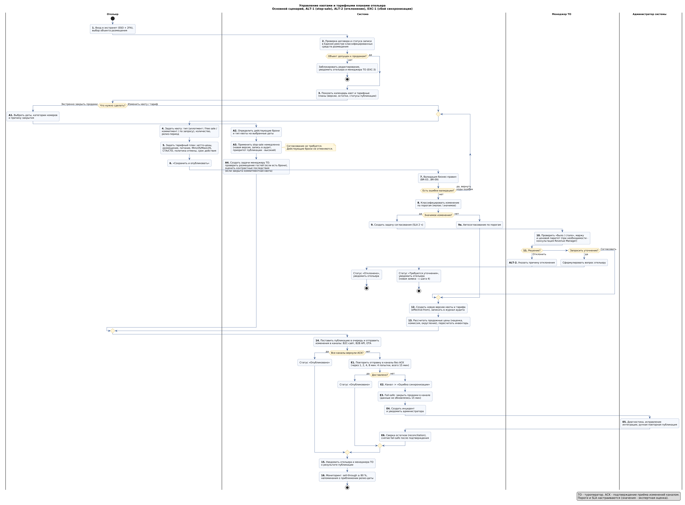
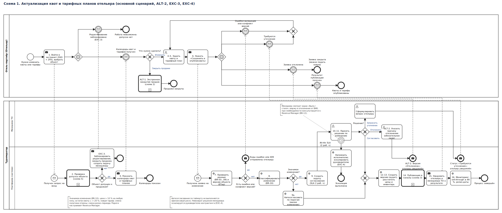
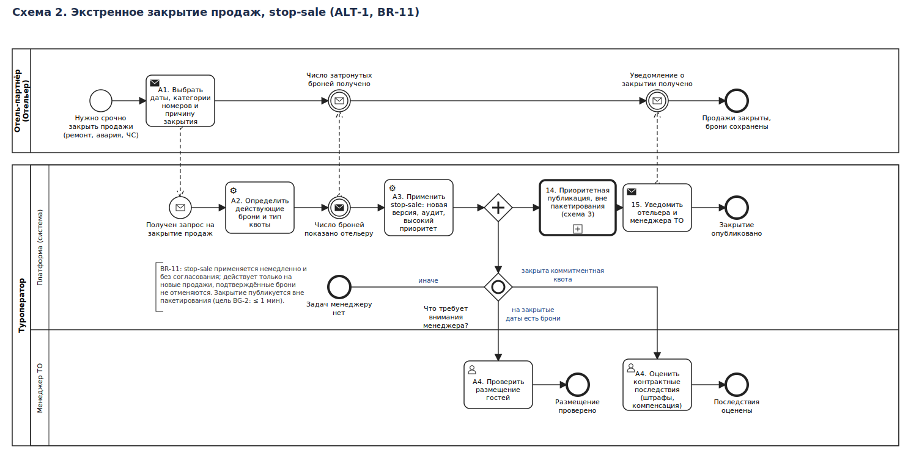
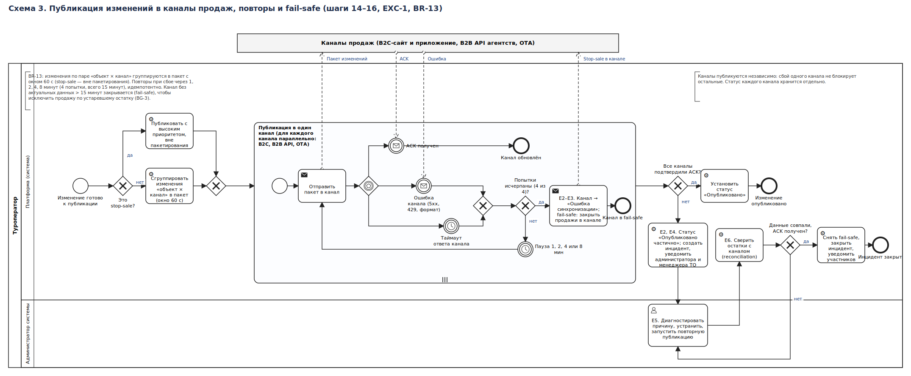
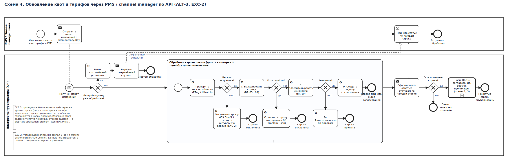
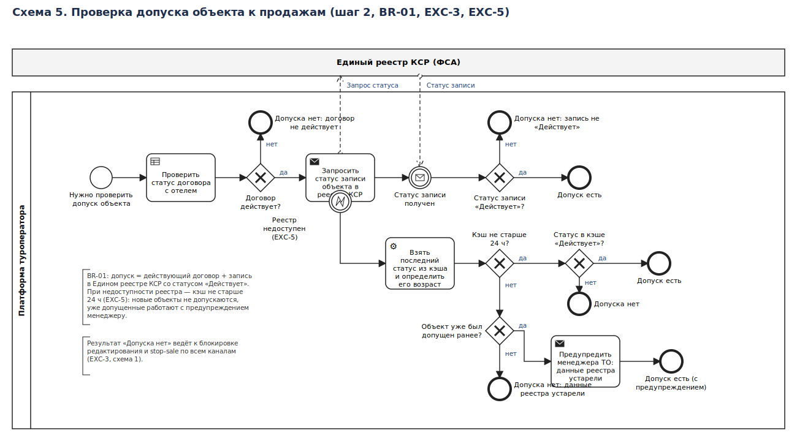

# Описание бизнес-процесса

**Процесс:** «Актуализация квот и тарифных планов отельера» (функция «Управление квотами и тарифными планами отельера»).
**Нотация:** UML Activity Diagram с дорожками (раздел 1) и BPMN 2.0 (раздел 8). **Дата актуализации:** 13.10.2026.

## 1. Диаграмма процесса

- Исходник: [`process_diagram.puml`](process_diagram.puml) (PlantUML). Изображение в полном размере - [`process_diagram.png`](process_diagram.png).
- Нумерация шагов на диаграмме совпадает с нумерацией ниже: **1-16** - основной сценарий, **A1-A4** - ALT-1, **E1-E6** - EXC-1.

## 2. Участники и системы

| Роль / система | Тип | Ответственность в процессе |
|---|---|---|
| **Отельер** | Внешний пользователь (сотрудник отеля) | Источник данных о квотах, ценах и ограничениях; закрывает продажи; исправляет замечания |
| **Менеджер туроператора** | Внутренний пользователь (контрактинг) | Согласует значимые изменения, оценивает контрактные последствия закрытия коммитментных квот, ведёт коммуникацию с отелем |
| **Revenue Manager** | Внутренний пользователь | Задаёт правила наценки и пороги значимости; консультирует менеджера при спорных ценах (прямого шага в основном потоке не имеет) |
| **Администратор системы** | Внутренний пользователь (поддержка / DevOps) | Мониторинг интеграций, разбор инцидентов публикации, управление доступами |
| **Платформа туроператора** («Система») | Информационная система | Хранение эталонного инвентаря и версий, валидация, расчёт цен, публикация, уведомления, аудит |
| **PMS / channel manager отеля** | Внешняя система | Альтернативный источник изменений по API (ALT-3) |
| **Каналы продаж** | Внешние системы | B2C-сайт и приложение, B2B API агентств, OTA-партнёры; принимают изменения и возвращают ACK |
| **Единый реестр КСР (ФСА)** | Внешний государственный реестр | Источник статуса записи об объекте размещения |

## 3. Предусловия и результат

**Предусловия**

1. Между туроператором и отелем заключён действующий договор; объект заведён в системе.
2. У отеля есть запись в Едином реестре классифицированных средств размещения со статусом «Действует».
3. Учётная запись отельера активна, назначена роль «Отельер» (RBAC) и включена 2FA.
4. В системе настроены категории номеров объекта и каналы продаж.

**Постусловия (успех).** Новая версия квоты и тарифа сохранена и записана в журнал аудита; инвентарь пересчитан; изменения получили ACK во всех целевых каналах (или канал переведён в fail-safe); отельер и менеджер уведомлены.

**Постусловия (отказ).** Состояние эталонного инвентаря и опубликованных данных не изменено либо изменено атомарно целиком; по каждому отказу есть запись в журнале и уведомление.

## 4. Бизнес-правила

| Код | Правило |
|---|---|
| **BR-01** | К управлению допускается объект с действующим договором и записью в Едином реестре КСР со статусом «Действует». При утрате допуска продажи приостанавливаются автоматически. |
| **BR-02** | Тип квоты - один из: *аллотмент*, *коммитмент*, *free sale*, *по запросу*. Тип задаётся на период и категорию номера. |
| **BR-03** | Сумма квот по всем договорам и каналам на дату не превышает номерной фонд категории за вычетом блокировок отеля. |
| **BR-04** | Квоту нельзя уменьшить ниже числа уже проданных номеров на дату; такие даты отклоняются валидацией. |
| **BR-05** | Релиз-период - целое число дней от 0 до 365. Для аллотмента остаток автоматически возвращается отелю за N дней до заезда; для коммитмента остаток не возвращается и учитывается в обязательстве выкупа. |
| **BR-06** | Нетто-цена строго больше 0, в рублях, с точностью до копеек; указывается за номер или за место в зависимости от тарифа. Периоды разных версий одного тарифа не пересекаются: новая версия закрывает предыдущую с даты *effective-from*. |
| **BR-07** | `MinLOS ≤ MaxLOS`, значения от 1 до 365; CTA и CTD задаются по датам. |
| **BR-08** | Политика отмены соответствует ПП РФ № 1912: отмена до дня заезда - полный возврат предоплаты; отмена в день заезда или неявка - удержание не более стоимости одних суток; досрочный выезд - возврат за неиспользованные ночи. Тарифы с иными условиями блокируются. *Трактовка основана на разъяснениях отраслевых юристов (по состоянию на 03.08.2026) и подлежит подтверждению юридическим отделом.* |
| **BR-09** | Если тариф содержит скидку, хранятся базовая цена и размер скидки в процентах (для раскрытия потребителю до бронирования). |
| **BR-10** | **Значимое изменение** (требует согласования): изменение нетто-цены более чем на 10 % на любую ночь; снижение остатка квоты более чем на 20 %; новый тарифный план; смена политики отмены; изменение релиз-периода. Остальные изменения - малые, применяются автоматически. SLA согласования - 2 часа в рабочее время (пн-пт, 09:00-18:00 МСК). *Пороги и SLA - экспертная оценка, настраиваются Revenue Manager.* |
| **BR-11** | Stop-sale применяется немедленно и без согласования, действует только на новые продажи и не отменяет подтверждённые брони. При закрытии коммитментной квоты менеджеру создаётся задача оценить контрактные последствия (штрафы, компенсация). |
| **BR-12** | Продажная цена = нетто-цена с наценкой/комиссией по правилам Revenue Manager, округление вверх до целого рубля. Отклонение от BAR более чем на 5 % формирует предупреждение менеджеру **[экспертная оценка]**. |
| **BR-13** | Публикация: изменения по паре «объект × канал» группируются в пакет с окном 60 с (stop-sale - вне пакетирования); повторы при сбое: 1, 2, 4, 8 минут (4 попытки, в сумме 15 минут); при отсутствии актуальных данных в канале более 15 минут включается fail-safe (stop-sale в канале). |
| **BR-14** | Каждое изменение создаёт неизменяемую версию с автором, источником (`extranet` / `api` / `manager`), временем и причиной; хранение - 3 года после окончания действия версии, журнал аудита - не менее 3 лет. |

## 5. Основной сценарий (MS)

**Название:** «Отельер актуализирует квоту и тарифный план».
**Инициатор:** Отельер. **Частота:** от нескольких раз в день (сезон) до 1-2 раз в месяц.

| № | Исполнитель | Действие | Ссылки |
|---|---|---|---|
| 1 | Отельер | Входит в экстранет (SSO + 2FA) и выбирает объект размещения. | - |
| 2 | Система | Проверяет статус договора и запись объекта в Едином реестре КСР. Если допуска нет - блокирует редактирование и уведомляет отельера и менеджера (**EXC-3**). | BR-01 |
| 3 | Система | Отображает календарь квот и тарифных планов: текущие версии, остатки, проданное, статус публикации по каналам. | - |
| 4 | Отельер | Выбирает период и категорию номера, задаёт квоту: тип, количество, релиз-период. | BR-02...05 |
| 5 | Отельер | Создаёт или изменяет тарифный план: нетто-цены по периодам и размещению, план питания, MinLOS/MaxLOS, CTA/CTD, политика отмены, срок действия. | BR-06...09 |
| 6 | Отельер | Нажимает «Сохранить и опубликовать». | - |
| 7 | Система | Валидирует данные. При ошибках возвращает отельеру перечень ошибок с кодами; отельер исправляет данные (возврат к шагам 4-5). | BR-03...09 |
| 8 | Система | Классифицирует изменение по порогам: *малое* или *значимое*. | BR-10 |
| 9 | Система | Для значимого изменения создаёт задачу согласования менеджеру ТО (SLA 2 ч). Для малого - автосогласование (9a), переход к шагу 12. | BR-10 |
| 10 | Менеджер ТО | Анализирует экран «было / стало», маржинальность и отклонение от BAR; при необходимости консультируется с Revenue Manager. | BR-12 |
| 11 | Менеджер ТО | Принимает решение: **Согласовать**: шаг 12; **Отклонить** с причиной: **ALT-2**; **Запросить уточнение**: задача возвращается отельеру со статусом «Требуются уточнения». | - |
| 12 | Система | Создаёт новую версию квоты и тарифа (*effective-from*), записывает в журнал аудита. | BR-14 |
| 13 | Система | Рассчитывает продажные цены и пересчитывает инвентарь `квота − проданное − закрытое`. | BR-12 |
| 14 | Система | Ставит публикацию в очередь и отправляет изменения в каналы (B2C, B2B API, OTA); принимает ACK от каждого канала. При сбое - **EXC-1**. | BR-13 |
| 15 | Система | Устанавливает статус «Опубликовано» и уведомляет отельера и менеджера ТО. | - |
| 16 | Система | Включает мониторинг: уведомления при sell-through ≥ 80 % и напоминания за N дней до релиз-даты. | BR-05 |

**Результат:** актуальные квоты и тарифы доступны во всех каналах продаж, изменение прослеживается в аудите.

## 6. Альтернативные сценарии

### ALT-1. Экстренное закрытие продаж на дату (stop-sale)

**Условие запуска:** после шага 3 отельер выбирает действие «Закрыть продажи» (ремонт, авария, ЧС, ошибочная продажа на стороне отеля).

| № | Исполнитель | Действие |
|---|---|---|
| A1 | Отельер | Выбирает даты, категории номеров и причину закрытия. |
| A2 | Система | Определяет количество действующих броней на эти даты и тип квоты. Показывает отельеру число затронутых броней: они **не отменяются**. |
| A3 | Система | Применяет stop-sale немедленно, без согласования (BR-11): создаёт новую версию, пишет запись в журнал аудита, помечает публикацию приоритетной. |
| A4 | Система | Создаёт задачи менеджеру ТО: «Проверить размещение гостей» (если на закрытые даты есть брони) и «Оценить контрактные последствия» (если закрыта коммитментная квота). Далее выполняются шаги 14-16: закрытие публикуется в каналы вне пакетирования, цель - не более 1 минуты (BG-2). |

**Отличие от основного сценария:** нет шагов 8-13 (классификация, согласование, расчёт цен); приоритет публикации высокий; менеджер не согласует закрытие, а получает задачи.

### ALT-2. Менеджер отклонил изменение

**Условие:** на шаге 11 выбрано «Отклонить».

1. Менеджер указывает причину отклонения (обязательное поле).
2. Система присваивает версии статус «Отклонена», действующая версия остаётся без изменений.
3. Система уведомляет отельера с причиной; отельер может создать скорректированную заявку (возврат к шагу 4).

### ALT-3. Обновление через PMS / channel manager по API

**Условие:** отель подключён по API (цель BG-6).

1. Channel manager отправляет пакет изменений квот и тарифов с `Idempotency-Key`.
2. Система выполняет шаги 7-9 без участия отельера в интерфейсе; ошибки возвращаются в ответе API (формат `application/problem+json`) с кодами правил BR.
3. Дальнейшие шаги 10-16 аналогичны основному сценарию.
4. Частично ошибочный пакет принимается по принципу «всё или ничего» для каждой строки `(дата × категория × тариф)`, итоговый ответ содержит статус по каждой строке.

## 7. Исключительные сценарии

### EXC-1. Ошибка синхронизации с каналом продаж

**Условие:** на шаге 14 канал не вернул ACK (таймаут, 5xx, 429, отклонение формата).

| № | Исполнитель | Действие |
|---|---|---|
| E1 | Система | Повторяет отправку только в каналы без ACK с экспоненциальной паузой 1, 2, 4, 8 минут (4 попытки, в сумме 15 минут); повторы идемпотентны. Остальные каналы публикуются независимо. |
| E2 | Система | Если все попытки исчерпаны, переводит канал в статус «Ошибка синхронизации», изменение - в «Опубликовано частично». |
| E3 | Система | **Fail-safe:** после последней неудачной попытки (канал не обновлялся 15 минут) закрывает продажи в этом канале (stop-sale), чтобы исключить продажу по устаревшему остатку (BG-3). |
| E4 | Система | Создаёт инцидент и уведомляет администратора и менеджера ТО. |
| E5 | Администратор | Диагностирует причину (доступы, формат, лимиты, недоступность канала), устраняет её и запускает повторную публикацию вручную. |
| E6 | Система | Выполняет сверку остатков; после успешного ACK и совпадения данных снимает fail-safe, закрывает инцидент, уведомляет участников. |

### EXC-2. Конфликт версий (одновременное редактирование)

Два пользователя изменили один тариф: при сохранении система сравнивает версию объекта (`ETag` / `If-Match`). Устаревшая запись отклоняется с кодом `409 Conflict`, пользователю показывается актуальная версия и различия; данные не затираются.

### EXC-3. Утрата допуска объекта

Объект исключён из Единого реестра КСР, договор расторгнут или приостановлен. Система блокирует редактирование и закрывает продажи по всем каналам с приоритетом, как при stop-sale; существующие брони сохраняются; менеджер ТО получает задачу связаться с отелем и гостями; решение о возобновлении принимается после восстановления допуска.

### EXC-4. Нарушение SLA согласования

Менеджер не принял решение за 2 рабочих часа: система напоминает исполнителю, затем эскалирует руководителю контрактинга. Автоматическое согласование по таймауту **не выполняется** (финансовый риск). Отельер видит статус «На согласовании» и ожидаемый срок.

### EXC-5. Недоступность Единого реестра КСР

При недоступности внешнего сервиса проверка шага 2 выполняется по кэшу (срок жизни не более 24 часов). Если кэш устарел, новые объекты не допускаются, а уже допущенные продолжают работу с предупреждением менеджеру.

## 8. BPMN-модели процесса

Те же сценарии смоделированы в нотации **BPMN 2.0**: пять диаграмм разного уровня детализации. Для каждой есть редактируемый файл `.bpmn` (открывается в [demo.bpmn.io](https://demo.bpmn.io), Camunda Modeler, bpmn.io), растровое изображение `.png` и `.svg`. Все файлы лежат в [`bpmn/`](bpmn/). Нумерация шагов (1-16, A1-A4, E1-E6) совпадает с разделами 5-7.

| № | Диаграмма | Что показывает | Сценарии | Файлы |
|---|---|---|---|---|
| 1 | Основной процесс (уровень 1) | Отельер, Менеджер ТО и Платформа в одной коллаборации; ссылки на детальные схемы через Call Activity | MS, ALT-2, EXC-2, EXC-3, EXC-4 | [png](bpmn/01_main_process.png), [bpmn](bpmn/01_main_process.bpmn) |
| 2 | Экстренное закрытие продаж | stop-sale без согласования, задачи менеджеру (инклюзивный шлюз) | ALT-1 | [png](bpmn/02_stop_sale.png), [bpmn](bpmn/02_stop_sale.bpmn) |
| 3 | Публикация в каналы | Пакетирование, мультиинстанс по каналам, повторы 1-2-4-8 мин, fail-safe, ручное восстановление | шаги 14-16, EXC-1 | [png](bpmn/03_publication.png), [bpmn](bpmn/03_publication.bpmn) |
| 4 | Обновление по API | Идемпотентность, обработка каждой строки пакета, конфликт версий | ALT-3, EXC-2 | [png](bpmn/04_api_update.png), [bpmn](bpmn/04_api_update.bpmn) |
| 5 | Проверка допуска объекта | Договор, Единый реестр КСР, кэш при недоступности реестра | шаг 2, EXC-3, EXC-5 | [png](bpmn/05_access_check.png), [bpmn](bpmn/05_access_check.bpmn) |

### 8.1. Схема 1. Основной процесс

### 8.2. Схема 2. Экстренное закрытие продаж (ALT-1)

### 8.3. Схема 3. Публикация в каналы (EXC-1)

### 8.4. Схема 4. Обновление по API (ALT-3, EXC-2)

### 8.5. Схема 5. Проверка допуска объекта (шаг 2, EXC-5)

### 8.6. Соответствие шагов процесса элементам BPMN

| Шаг / сценарий | Элемент BPMN | Схема |
|---|---|---|
| 1 Вход, выбор объекта | Send Task отельера + Message Flow на Message Start платформы | 1 |
| 2 Проверка допуска | Call Activity -> отдельный процесс; Error Boundary Event «Реестр недоступен» (EXC-5) | 1, 5 |
| 3 Показ календаря | Send Task платформы -> Message Catch отельера (Event-Based Gateway: календарь или блокировка) | 1 |
| 4-6 Ввод квоты и тарифа, сохранение | User Task + Send Task отельера -> Message Start платформы | 1 |
| 7 Валидация (BR-03...09), EXC-2 | Service Task + XOR-шлюз «Есть ошибки или конфликт версий?» | 1, 4 |
| 8-9 Классификация, 9a автосогласование | Service Task + XOR-шлюз «Значимое изменение?» | 1, 4 |
| 10-11 Решение менеджера | User Task в дорожке менеджера + XOR-шлюз (согласовать / отклонить / уточнить) | 1 |
| EXC-3 Утрата допуска | XOR «Объект допущен?» после Call Activity проверки; Send Task «заблокировать, закрыть продажи, создать задачу менеджеру» + Message Flow отельеру | 1, 5 |
| EXC-4 SLA 2 ч | Non-interrupting Timer Boundary Event на задаче менеджера (без автосогласования) | 1 |
| ALT-2 Отклонение | Ветка шлюза решения -> Message End Event «Отклонение с причиной» | 1 |
| 12-13 Версия, цены, инвентарь | Service Task | 1 |
| 14 Публикация, E1-E6 | Call Activity -> процесс с Multi-Instance Sub-Process по каналам, Timer, Event-Based Gateway, fail-safe | 1, 3 |
| 15-16 Уведомление, мониторинг | Send Task, Service Task | 1 |
| ALT-1 stop-sale A1-A4 | Parallel Gateway (публикация и задачи менеджеру), Inclusive Gateway с default-потоком | 2 |
| ALT-3 API | Message Start, XOR «Idempotency-Key уже обработан?», Multi-Instance Sub-Process по строкам | 4 |

### 8.7. Условные обозначения и принятые допущения

- **Пулы:** «Отель-партнёр», «Туроператор» (дорожки «Платформа» и «Менеджер ТО» / «Администратор системы»), внешние системы (реестр КСР, каналы продаж) показаны как «чёрные ящики» без внутренней логики.
- **Потоки:** сплошная стрелка - Sequence Flow внутри одного пула; пунктир - Message Flow между пулами. Между дорожками одного пула ходят только Sequence Flow.
- **Call Activity** (жирная рамка со знаком «+») - вызов отдельной схемы; номер схемы указан в названии.
- **Допущения.** Решение менеджера, проверка допуска и публикация - независимые процессы; значения порогов, SLA и повторов взяты из бизнес-правил BR-10 и BR-13 и на диаграммах не изобретались. Таймаут ответа канала не задан в бизнес-правилах и показан как параметр без значения.
